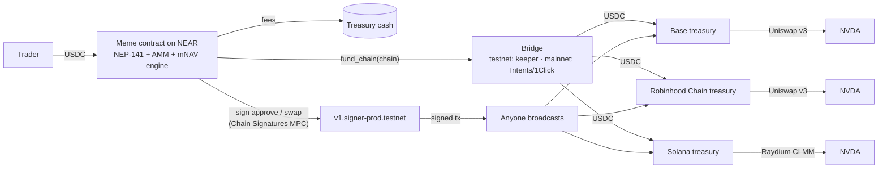

# Solidon

**Memes with a balance sheet.** Solidon is a memecoin launchpad on NEAR where every meme is a small treasury company. Trading fees buy a tokenized stock (NVIDIA, Apple, Tesla and five more) on Base, Robinhood Chain and Solana at the same time. The NEAR contract signs every treasury transaction itself through Chain Signatures, and its capital rules (issue above 2× NAV, buy back below 1×, open redemptions below 0.9×) are locked in code with no admin key.

Built for NEAR HACKATHON 2026 · Tracks: `defi`, `memecoins` · Author: [@yeheskieltame](https://github.com/yeheskieltame)

**Live demo:** [solidon.xyz](https://solidon.xyz) · app [app.solidon.xyz](https://app.solidon.xyz) · read API [api.solidon.xyz/health](https://api.solidon.xyz/health)

> Everything runs on testnets. The stock tokens are synthetic, priced from the official Chainlink feeds on Robinhood Chain mainnet, and the test USDC has no value.

## Why

Memecoins have attention but nothing underneath: when the hype fades, holders are left with a token backed by nothing. Treasury companies such as MicroStrategy do the opposite: they hold an asset and grow the amount held per share by issuing shares at a premium. Solidon gives every meme that second engine. Hype becomes stock per token, and a NAV floor that anyone can verify on-chain.

**mNAV** = meme market cap ÷ treasury value. The contract acts on it every hour from a 30-minute TWAP and a fresh oracle price:

| mNAV | Action, enforced by the contract |
| --- | --- |
| above 2.0× | Issue new tokens (at most 1% of supply per day) and buy more stock: accretive for every holder |
| 1.0× – 2.0× | Hold |
| below 1.0× | Buy back with cash above the 20% buffer (never sells stock to do it) |
| below 0.9× | Open redemptions: burn tokens for NAV per token in USDC |

## How it works



- **One NEAR contract owns three treasuries.** Each meme derives an EVM address (ECDSA, used on Base and Robinhood Chain) and a Solana address (EdDSA) from the NEAR MPC network. The contract builds every transaction itself from locked config: an approval to one router, a swap into its stock, a USDC transfer. It checks each signature (`ecrecover`, `ed25519_verify`) before storing it. Anyone can broadcast.
- **Cash moves with proof where proof exists.** Base arrivals are credited only after the MPC verifies the USDC `Transfer` log (foreign-chain verification). Robinhood Chain and Solana arrivals are reported by the relayer. Every credit is capped by the cash in transit and booked once.
- **The ledger books the minimum.** Each swap books the `minAmountOut` it signed for, so a swap that lands leaves the chain a little above the ledger. A swap that reverts on-chain (for example when the pool has drifted more than 1% from the oracle) stays booked while its USDC sits unspent in the treasury. The app flags that chain "Less on-chain", as it does today for HONEY on Base ([reverted swap](https://sepolia.basescan.org/tx/0x9609b7e27e2f741c4286a6c6a1a6dd04867a4d7f6c1b60c092aea942ef7e27fb)).

## Try it (do X, see Y)

### 1. Read the live state, no setup

| Do | See |
| --- | --- |
| Open [`solidon.testnet` on NearBlocks](https://testnet.nearblocks.io/address/solidon.testnet) | The factory: 8 stocks, 3 chains, the memes it launched |
| Run `near contract call-function as-read-only honey.solidon.testnet get_treasury_chains json-args '{}' network-config testnet now` | HONEY's treasury per chain: address, nonce, USDC, NVDA booked, cash in transit |
| Open HONEY's [Solana treasury](https://explorer.solana.com/address/9gyosY8RFLdET2AGVj5XU14tpRGLFrun2VrpfZ1tAsLP?cluster=devnet) and [EVM treasury on Robinhood Chain testnet](https://explorer.testnet.chain.robinhood.com/address/0x51b1197be727ce2fb229c4919eca30e5568c802a) | NVDA bought by swaps the NEAR contract signed (example Solana buy: [`3ZfTyZ…`](https://explorer.solana.com/tx/3ZfTyZCAHrGcvd4yUupeWrGG2YC4Lm6e3SakxTtsKn4SGis9FX4bbJEk2Ky?cluster=devnet)) |
| Read [docs/DEPLOYMENTS.md](docs/DEPLOYMENTS.md), "End to end" | One meme holding NVDA on all three chains: every MPC signature, bridge transfer, cash proof and swap, with links |

### 2. Use the app (hosted at [app.solidon.xyz](https://app.solidon.xyz), or run it locally)

```bash
cd frontend && npm install && npm run build && npm run start   # landing http://localhost:3000 · app http://app.localhost:3000
cd backend/keeper && npm install && node indexer.js              # optional locally: charts, activity, holders (no key, never signs)
```

| Do | See |
| --- | --- |
| Open the app → **Try a demo wallet** | A new NEAR testnet account in your browser with NEAR for gas and 1,000 test USDC: no extension, no popups |
| Or connect your own wallet → **Get test funds** | Test NEAR and 1,000 USDC arrive without you paying gas (server-side faucet) |
| Open **HONEY** → Buy 10 USDC | Your tokens, the fee split, and the treasury value rising |
| Details → **Holders** | Every holder read from `ft_balance_of`, your wallet tagged "You" |
| Details → **Treasury per chain** | Ledger vs on-chain balance on Base, Robinhood Chain and Solana |
| Buy → **Pay from another chain** | Live NEAR Intents 1Click quotes from SOL, ETH on Base, BTC or USDC on Arbitrum |
| **Launch** | Create your own meme: pick a stock, seed the pool, open the treasury |

### 3. Run the tests

| Do | See |
| --- | --- |
| `cd contracts && cargo test` | Unit tests plus NEAR sandbox integration tests (factory → meme → pool → mNAV → signing) |
| `cd backend/keeper && npm test` | 56 keeper tests (treasury steps, bridge, Solana re-sign, holders), no network |
| `python3 simulation/sim.py` | The 60-day simulation below, regenerated from scratch |

## 60-day simulation

Five scenarios, 12 seeds each, 5-minute steps, the contract's exact rules ([simulation/RESULTS.md](simulation/RESULTS.md)):

| Scenario | Meme | Stock | NAV/token | Stock units/token | Worst min mNAV |
| --- | --- | --- | --- | --- | --- |
| Steady bull | +31.1% | +28.7% | +47.9% | +13.1% | 1.07 |
| Bull then hype fades | -24.7% | +28.7% | +56.6% | +29.1% | 0.87 |
| Stock crash | -46.9% | -31.6% | +3.9% | +68.8% | 0.87 |
| Sideways chop | -19.6% | -4.7% | +22.1% | +34.7% | 0.88 |
| Weekend gap | -19.0% | +0.0% | +18.5% | +22.9% | 0.88 |

Every issuance was accretive in every seed. mNAV recovered above 0.9 within 2 hours whenever it dipped, and no rule fired on a stale oracle. The simulation also changed the spec: a buyback that sells stock to refill cash destroys NAV. The adopted rule spends only cash above the 20% buffer.

## Trust assumptions and threat model

Stated openly. The full table is in [docs/SPEC.md](docs/SPEC.md#trust-assumptions--threat-model).

- **No admin key.** No method lets anyone move treasury funds. The treasury addresses belong to the meme contract via MPC, and the contract signs only an approve to a locked router and a swap into its locked stock.
- **Holdings are booked, not read.** The ledger records each swap's `minAmountOut` when it is signed, and the app shows the real explorer balance next to it. On EVM chains, a signed swap that reverts is not unbooked yet: the value stays in the treasury as USDC, but the stock figure overstates until holdings are proven (next step: book Base swaps on an MPC-verified log, as cash already is).
- **Cash on Robinhood Chain and Solana is relayer-reported.** Only Base arrivals are MPC-proven. A relayer report is capped by cash in transit, once per transaction, so it cannot create value.
- **The testnet bridge is a trusted keeper account.** On mainnet that leg is NEAR Intents / 1Click.
- **Manipulation brakes.** 30-minute TWAP, 1-hour cooldown, 1%/day issuance cap, 15-minute oracle staleness stop, 1% max slippage per swap, per-chain swap cap.
- **The floor is a NAV floor, not a price guarantee.** If the stock falls, NAV falls with it.

## Repository

| Path | Contents |
| --- | --- |
| [`contracts/`](contracts) | Rust (near-sdk): `meme` (NEP-141, AMM, mNAV engine, EVM and Solana treasuries), `factory`, `mock-ft`; stock venue registries |
| [`backend/`](backend) | Node.js keeper (oracle push, housekeeping, broadcaster, testnet bridge, indexer + read API) and spike scripts |
| [`frontend/`](frontend) | Next.js landing + app (Markets, Launch, Dashboard, meme pages) |
| [`simulation/`](simulation) | 60-day mNAV simulation |
| [`docs/`](docs) | [Spec](docs/SPEC.md), [deployments](docs/DEPLOYMENTS.md), [integration spikes](docs/SPIKE.md), [references](docs/REFERENCES.md), [hackathon rules](docs/HACKATHON_RULES.md) |

## Hackathon disclosures

- **No baseline code.** This repository was created on 8 Nov 2026, inside the hackathon window, and every commit is new work. The submitted commit carries the tag `hackathon-submission`.
- **Other project by the same author:** NYXERON, an independent project, submitted separately.
- **Tools & disclosure**
  - **AI:** Claude Code was used throughout for code, tests and docs, under the author's direction and review. GPT Image (ChatGPT) generated the mascot and meme art.
  - **Libraries:**
    - Contracts: near-sdk, cargo-near.
    - Backend: near-api-js, viem, @solana/web3.js, Raydium SDK v2 (devnet pool setup only).
    - Frontend: Next.js, Tailwind CSS, shadcn/ui, Motion, @hot-labs/near-connect.
    - Simulation: Python standard library.
  - **Services:**
    - Signing: NEAR Chain Signatures (`v1.signer-prod.testnet`).
    - Prices: Chainlink price feeds (Robinhood Chain mainnet).
    - Cross-chain entry: NEAR Intents 1Click (quotes).
    - Chain access: FastNear and dRPC (NEAR), Alchemy (EVM, Solana).
  - **Assets:** the hero background is a licensed MotionSites gradient. Stock, chain and platform logos are trademarks of their owners; sources are in [`frontend/public/logos/SOURCES.md`](frontend/public/logos/SOURCES.md).
- **Not for US persons.** Tokenized stocks are regulated securities in many places. This is a testnet prototype with synthetic tokens.

## License

[MIT](LICENSE)
