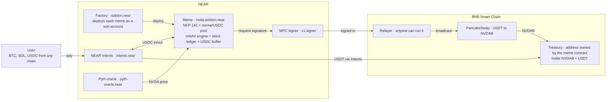
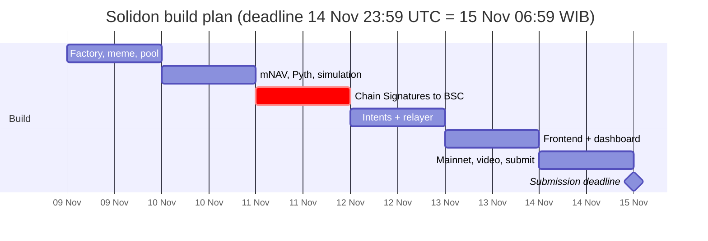

# Solidon — Product & Technical Spec

Version: 8 Nov 2026 · Owner: [@yeheskieltame](https://github.com/yeheskieltame) · Living version: [Claude Doc](https://claude.ai/artifact/HZkuPm9XMMWj3UmzHVEGU6)

## Summary

Solidon is a memecoin launchpad on NEAR where every meme is an on-chain treasury company that holds real tokenized stocks (bStocks on BNB Smart Chain), with capital rules locked in the contract. Tagline: *Memes with a balance sheet.*

**Problem**

- Traders pair memes with stocks because they want the stock's direction with more volatility. Today's stock-paired memes deliver that, but with no floor: the meme part can collapse to zero while the stock is fine.
- Memecoins have no underlying value. When the hype ends, holders are left with nothing.
- Treasury companies (MicroStrategy, SVRN) can only be bought through stock exchanges, and their share issuance is decided by management, not by code.
- bStocks only live on BSC. Users on NEAR, Solana, or Bitcoin cannot reach them easily.

**Solution**

- Every meme owns a treasury of real stocks at a BSC address controlled by the NEAR contract through Chain Signatures. No custodian, no admin key.
- **Same direction as the stock, more aggressive, with a floor.** The meme's NAV follows the stock, the hype premium amplifies it, and the contract defends NAV when the premium collapses.
- An asymmetric mNAV engine: the upside is allowed to run (issuance only at a high premium, small and accretive), while the downside is defended (redemption at NAV well below NAV, plus a small buyback from surplus cash below NAV).
- Enter and exit from any chain through NEAR Intents.

**Tracks:** Unstoppable DeFi (`defi`) and Memecoins With Mechanics (`memecoins`).

## Core concept: NAV and mNAV

The meme may trade above the value of its stocks (premium = hype), but it cannot stay below it for long, because the contract buys back or opens redemption.

```latex
\text{NAV per token} = \frac{\text{stock units} \times \text{Pyth price} + \text{USDC cash (NEAR)} + \text{USDT cash (BSC)}}{\text{circulating supply}}
```

```latex
\text{mNAV} = \frac{\text{meme price in the pool}}{\text{NAV per token}}
```

The analogy is MicroStrategy: when its shares trade at a premium to the Bitcoin it holds, the company issues new shares to buy more of the asset. The difference is that in Solidon the rule is written in code and runs automatically, the same for everyone. SVRN, a partner of this hackathon, is a NEAR treasury company that also reports mNAV, so judges already speak this language.

### Why memes + stocks: aggressive exposure with a floor

People mix memes and stocks for one reason: they want the stock's direction with more volatility. On BNB Chain and Robinhood Chain this already happens through stock-paired memes, where part of the price comes from the real stock and part from hype. The chart follows the stock, but moves harder. The weakness is that nothing holds the hype part up, so it can collapse to zero even when the stock is fine.

Solidon keeps the aggressive behaviour and adds a floor:

```latex
\text{meme return} \approx \text{leverage} \times \text{stock return} + \Delta\,\text{premium}
```

| Part of the return | Where it comes from | Behaviour |
| --- | --- | --- |
| Stock return | NAV per token follows the bStock price | Same direction as the real stock |
| Premium change | mNAV, driven by hype and demand | Amplifies moves, especially upward |
| Leverage | Stock units per token (and, later, borrowing) | Grows over time through accretive issuance |
| Floor | Redemption at NAV below 0.9 × NAV, small buyback below NAV | The meme cannot stay far below the value of its stocks |

The floor is a NAV floor, not a price guarantee. If the stock itself falls, NAV falls with it. What the floor removes is the extra loss from the hype premium collapsing below zero.

### Asymmetric engine: let the upside run, defend the downside

- **Upside runs.** Issuance only starts at a high premium (mNAV > 2.0) and is capped small, so the premium can expand when the stock rallies.
- **Issuance is accretive.** New memes are only sold above NAV, so every issuance buys more stock than it dilutes. Stock units per token rise, which makes the meme more sensitive to the stock over time. This is the MicroStrategy flywheel, enforced by code.
- **Downside is defended.** Far below NAV, holders can redeem for USDC at NAV per token, which is value-neutral for everyone who stays. Below NAV, surplus cash buys back and burns.

### Leverage (roadmap)

A later version lets a meme borrow against its stocks to target 1.5–2× exposure: the treasury supplies bStocks as collateral on Venus, borrows USDC, and buys more stock. Venus already accepts tokenized stocks as collateral on BNB Chain. This adds liquidation risk, handled by an automatic deleveraging rule (repay debt when the loan-to-value rises, borrow more when it falls). It is out of scope for the hackathon MVP and is presented as roadmap.

## Features

The MVP focuses on one complete flow that can be proven on-chain. Everything else is written as vision in the README.

| Feature | Description | Priority |
| --- | --- | --- |
| Launchpad (factory) | Anyone deploys a new meme as a sub-account, e.g. `nvda.solidon.near`, with its thesis stock and locked parameters | MVP |
| Meme token (NEP-141) | Standard NEAR token, supply controlled by the mNAV engine | MVP |
| Internal meme/USDC pool | Constant-product AMM inside the meme contract, price read directly for mNAV | MVP |
| BSC treasury via Chain Signatures | One BSC address per meme, derived from the meme account + path, holding a bStock (NVDAB) | MVP |
| Asymmetric mNAV engine | Small accretive issuance only at a high premium, buyback + burn below NAV, brake when the oracle is stale | MVP |
| USDC redemption | Burn memes and receive NAV per token in USDC, paid from cash, when mNAV < 0.9 | MVP |
| Enter from any chain | Pay with BTC/SOL/USDC from other chains through Intents 1Click, arriving as USDC on NEAR | MVP |
| Proof dashboard | NAV, mNAV, stocks held + BscScan link, stock units per token, meme vs stock chart, log of every mint/burn/buy | MVP |
| 60-day simulation | Script that simulates supply, NAV, and meme price against the stock under several market scenarios | MVP |
| Leverage via Venus | Borrow USDC against bStocks to target 1.5–2× exposure, with automatic deleveraging | Roadmap |
| Keeper on OutLayer (TEE) | Rebalance and BSC balance reads with attestation | Later |
| Redeem to another chain | Redemption payout straight to a chain of choice via Intents | Later |
| Multi-stock memes | One meme holding a basket of several bStocks | Later |

## Architecture



The meme contract on NEAR is the only owner of the BSC treasury: it requests a signature from the MPC signer `v1.signer`, and anyone can broadcast the signed transaction. Funds move in and out through Intents, and stock prices come from Pyth.

Stack: Rust contracts (near-sdk + Omni Transaction), Node.js relayer and keeper, Next.js + shadcn frontend with a black-and-white palette.

## Mechanics & locked parameters

Every parameter is set at launch, readable by anyone, and there is no admin function to change it. The numbers below are initial proposals, locked after the 60-day simulation.

| Parameter | Initial proposal | Purpose |
| --- | --- | --- |
| Pool swap fee | 1% per trade | 0.8% to treasury, 0.2% to creator |
| Issuance threshold | mNAV > 2.0 | Contract mints new memes and sells them into the pool; proceeds buy stock. Set high so the premium can run |
| Max issuance per epoch | 1% of circulating supply per 24 hours | Small enough not to cap a rally, prevents sudden dilution |
| Accretion rule | Issue only if stock units per token after ≥ before | Every issuance increases exposure per token; enforced as a contract invariant |
| Buyback threshold | mNAV < 1.0 | Contract uses USDC cash **above the 20% buffer** to buy memes from the pool, then burns them. Never sells stock to fund a buyback (finding #12) |
| Redemption threshold | mNAV < 0.9 | Holders can burn memes and receive NAV per token in USDC from cash |
| Cash buffer on NEAR | 20% of NAV | Cash ready for buybacks and redemptions without waiting for a stock sale on BSC |
| Pool price for mNAV | 30-minute TWAP | Prevents short-term price manipulation |
| Oracle staleness limit | 15 minutes | If the Pyth feed is older than this, all mNAV actions stop |
| Rebalance cooldown | 1 hour | One mNAV action per hour, triggered by anyone via `rebalance()` |
| Caller tip | 0.05% of the action value | Incentive for anyone who calls `rebalance()` |
| Max swap per BSC transaction | 500 USDT on testnet; sized to the thinnest listed pool on mainnet | Pool fee (0.25%) + price impact must stay below the 1% slippage allowed against Pyth, or the swap reverts. Larger balances are swapped over several transactions |
| Target leverage | 1.0× (MVP), 1.5–2.0× (roadmap) | Exposure to the stock per unit of NAV; above 1.0× requires borrowing on Venus |

**Cash ordering rule.** Redemptions use the USDC buffer on NEAR. If the buffer falls below 10% of NAV, the contract schedules a partial stock sale on BSC to refill it to 20%. Buybacks only spend cash above the 20% buffer and never trigger a stock sale: bought-back tokens come from the pool's inventory, so circulating supply does not fall and each buyback lowers NAV per token (finding #12, `simulation/RESULTS.md`).

**Circulating supply** is total supply minus the pool's meme inventory. NAV per token and the issuance cap use it.

## User and system flows

Users only see buy, sell, and redeem. All cross-chain work happens in the background.

**Launch (creator)**

1. The creator picks a name, ticker, and thesis stock (MVP: NVDAB).
2. The creator deposits initial USDC as the pool's first liquidity.
3. The factory deploys the meme contract as a sub-account and locks every parameter.
4. The meme contract derives its own BSC treasury address through Chain Signatures.

**Buy (user)**

1. The user picks an amount and pays with an asset from any chain.
2. Intents 1Click converts it to USDC on NEAR.
3. USDC is swapped for the meme in the internal pool. A 0.8% fee goes to the treasury.

**Fund the treasury (system)**

1. When USDC cash on NEAR exceeds the 20% buffer, the surplus is sent via Intents as USDT to the treasury address on BSC.
2. Anyone calls `rebalance()`. The contract builds a PancakeSwap swap transaction (USDT to NVDAB) with `minAmountOut`.
3. The contract requests a signature from `v1.signer`. A relayer broadcasts the signed transaction to BSC.
4. The stock ledger in the contract is updated.

**mNAV engine (system, every rebalance)**

1. The contract reads the NVDA price from Pyth and the meme TWAP from the pool.
2. The contract computes NAV and mNAV.
3. mNAV > 2.0: small accretive issuance. 1.0 ≤ mNAV ≤ 2.0: no action, the premium moves freely. mNAV < 1.0: buyback + burn from surplus cash only. mNAV < 0.9: redemption window opens. Stale oracle: no action.

**Sell or redeem (user)**

1. Sell: swap the meme to USDC in the pool, withdraw to any chain.
2. Redeem (while the window is open): burn memes, receive NAV per token in USDC from the cash buffer.

## Trust assumptions & threat model

The MVP knowingly accepts one trust assumption: the NEAR contract cannot read BSC balances, so the stock ledger is recorded conservatively. This is stated openly in the README.

| Threat | Mitigation |
| --- | --- |
| Creator or admin drains the treasury | No admin key. The BSC address can only be signed for by the meme contract via MPC, and the contract only signs swap transactions to a whitelisted PancakeSwap router |
| Stock ledger drifts from the BSC balance | The ledger records `minAmountOut`, not an estimate. The dashboard shows the real BscScan balance next to the ledger. Upgrade: OutLayer TEE reads the balance and attests to it |
| Pool price manipulation to trigger issuance or buyback | mNAV uses a 30-minute TWAP, a 1-hour cooldown, and issuance capped at 1% of supply per day |
| Stale oracle while the stock market is closed | All mNAV actions stop if the Pyth feed is older than 15 minutes. Pool trading keeps working |
| Bank run on redemptions | Redemptions only draw on the cash buffer. A queue forms if the buffer runs out, and a stock sale is scheduled to refill it |
| bStock issuer blocks the treasury, pauses the token, or upgrades it | Accepted trust assumption (bStocks are regulated securities tokens with a blocklist, a pause switch, and an upgradeable beacon; no allowlist today). Stock sales stop, the stock is still valued at the Pyth price, and redemptions use the USDC cash buffer on NEAR. Evidence: docs/STOCKS.md |
| Fake token with a bStock symbol | The factory's stock list is immutable and verified by `contracts/stocks/verify.py`, which binds each token to its official PancakeSwap v3 USDT pool |
| Relayer withholds transactions | Anyone can broadcast a signed transaction. The official relayer is a convenience, not a trust point |
| Front-running the swap on BSC | `minAmountOut` is computed from the Pyth price with at most 1% slippage. Each swap is capped (`max_swap_usdt`) so fee + impact fit inside that 1%; a fork simulation showed a 1,000 USDT swap into a 100k-USDT pool costs 1.25% and would revert |
| A callback panics on an unexpected MPC or Pyth response and locks the contract (no owner can reset it) | Callbacks that hold state (signing, redemption) parse raw results with a size bound and never panic: a bad response refunds or frees the slot. `clear_stuck_signature` frees a signing slot after 300 blocks as a last resort |
| The MPC network returns a wrong or malicious signature | The contract runs `ecrecover` on every signature and stores the transaction only if it recovers to its own treasury address |
| Nobody pays BSC gas for the treasury | Liveness only: the treasury address needs a little BNB for gas. Anyone can top it up; on mainnet Intents can deliver BNB with the cash |
| Premium bubble then crash | The floor only defends NAV: buyback below 1.0×, redemption below 0.9×. Issuance is accretive, so a bubble leaves holders with more stock per token, not less |
| Users read the floor as a price guarantee | UI and README state that the floor is a NAV floor: if the stock falls, NAV falls with it |
| Liquidation of a leveraged treasury (roadmap) | Automatic deleveraging: repay debt when loan-to-value rises above a locked limit, borrow more only below a lower limit. Not part of the MVP |

## Risks & mitigations

The biggest risk is time: Chain Signatures to BSC is the most complex part, so it is built first with a clear fallback.

| Risk | Impact | Mitigation |
| --- | --- | --- |
| Building and signing EVM transactions from a Rust contract takes too long | Cross-chain demo fails | Use the Omni Transaction library. Fallback: the relayer builds the transaction off-chain, the contract only validates the hash and requests the signature |
| bStocks are not on BSC testnet | Cannot test on testnet | Test the signing flow with a mock token on BSC testnet, then run once on mainnet with a small amount |
| Thin NVDAB liquidity on PancakeSwap | High slippage | Small demo amounts, check the pool before the demo, or switch to the bStock with the deepest pool |
| bStock trading paused during a corporate action | Rebalance fails | Rebalance is skipped automatically and retried next epoch |
| Pyth equity feeds do not update on weekends | mNAV cannot be computed | Stale-oracle brake. Record the demo while US markets are open |
| Intents has no testnet | Mainnet cost | Separate dev account, small amounts, `dry: true` quotes during development |
| bStocks compliance (non-US) | Regulatory concern | Disclaimer in README and UI, access for non-US users |

## Track & judging map

Solidon uses both official DeFi track hints (Intents and Chain Signatures) and every requirement from the Memecoins example prompt.

| Criterion | Official wording | Evidence in Solidon |
| --- | --- | --- |
| `defi`: cross-chain settlement | Settle across chains through NEAR Intents | Enter from any chain via 1Click, cash sent to BSC via Intents |
| `defi`: no custodian | No custodian, nobody to switch it off | Treasury at a contract-owned address via Chain Signatures, `rebalance()` callable by anyone |
| `defi`: exchange/vault | Build exchanges, vaults | Internal AMM pool + per-meme stock vault |
| `memecoins`: mechanic in the contract | Mechanic in the contract, not a backend | mNAV engine, issuance, buyback, redemption all in the contract |
| `memecoins`: locked parameters | No admin key | Parameters locked at launch, publicly readable |
| `memecoins`: treasury with rules | Treasuries with rules | Cash buffer, issuance cap, redemption window |
| `memecoins`: simulation | Simulate 60 days | Simulation of supply, NAV, and meme price against the stock across five scenarios, results in the README |
| `memecoins`: sybil | Sybil resistance documented | No per-account rewards; every mechanic is proportional to token amount, so splitting accounts gains nothing |

The AI judges (Claude Code and Codex) screen for reproducibility, so the README must include "do X, see Y" steps.

## Simulation plan

The 60-day simulation proves the core claim: **same direction as the stock, more aggressive, with a floor.** It runs the locked parameters against simulated stock prices and meme demand, and the parameters are only locked once every check passes.

| Scenario | Stock path | Meme demand | What must hold |
| --- | --- | --- | --- |
| Steady bull | +30% over 60 days | Rising | Meme return > stock return; stock units per token rise after each issuance |
| Bull then hype fades | +30%, then flat | Rising, then falling | Meme falls back toward NAV; mNAV is back at ≥ 0.9 within 2 hours of dropping below |
| Stock crash | −30% | Panic selling | Meme falls with the stock; redemption brings mNAV back to ≥ 0.9 within 2 hours |
| Sideways chop | ±5% swings | Random | No runaway issuance; supply changes stay within the epoch cap |
| Weekend gap | Flat, oracle stale for 48 hours | Random | No mNAV action during staleness; the pool keeps trading |

Reported metrics per scenario: correlation between meme and stock returns, beta of the meme to the stock, maximum drawdown versus the stock, lowest mNAV reached, total supply change, and stock units per token at day 60.

**Result (9 Nov 2026, 12 seeds per scenario): every check passes with the parameters above, which are now locked.** The floor is stated as "back at ≥ 0.9 within 2 hours" because the redemption window only opens once mNAV is already below 0.9. Worst case across all runs: min mNAV 0.87, at most 1 hour below 0.9. Full tables and charts: [simulation/RESULTS.md](../simulation/RESULTS.md).

## Daily build plan



Chain Signatures is built before the UI because it carries the most risk. If BSC transactions still cannot be signed from the contract by the night of 11 Nov, switch to the fallback immediately: the relayer builds the transaction off-chain, and the contract only validates it and requests the signature.

## Submission checklist & open questions

Deadline: 14 Nov 2026 23:59 UTC, or 15 Nov 06:59 WIB.

**Checklist**

- [ ] Public repo with the tag `hackathon-submission` on the submitted commit
- [ ] README states there is no baseline code: the repo was created on 8 Nov 2026 and every commit is inside the window
- [ ] README names NYXERON as the other project by the same person
- [ ] README includes "do X, see Y" steps, threat model, trust assumption, and 60-day simulation results
- [ ] LICENSE file (MIT)
- [ ] Hosted demo stays live until 18 Nov, ideally 25 Nov
- [ ] Demo video shows one complete moment: buy a meme, stock bought on BSC, mNAV dashboard updates
- [ ] X post says it was built at NEAR HACKATHON and tags @NEARProtocol and #NEARHackathon
- [ ] NEAR mainnet account for the prize payout
- [ ] Submit once with tracks `defi` and `memecoins`

**Open questions**

- Is the NVDAB pool on PancakeSwap deep enough for the demo, or should another bStock be used?
- The Pyth feed ID for NVDA/USD on NEAR mainnet.
- Use Omni Transaction inside the contract, or take the off-chain transaction-building fallback?
- Get a 1Click JWT to avoid the 0.2% fee?
- ~~Is an issuance threshold of 2.0× and a 1% epoch cap the right balance?~~ Yes: a sweep of {2.0, 2.5, 3.0} × {0.5%, 1%} kept the floor identical, and a 0.5% cap hurt the bull case. Kept 2.0× and 1%.
- Leverage roadmap: confirm Venus supports the chosen bStock as collateral, and its loan-to-value limits.
