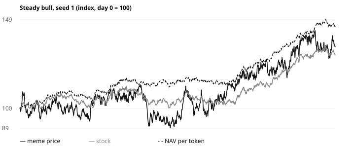
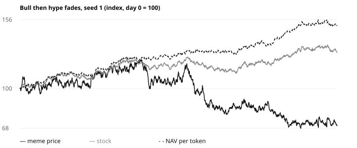
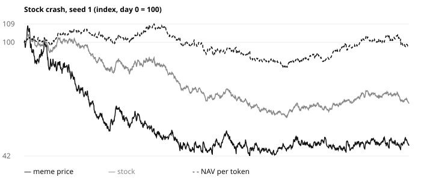
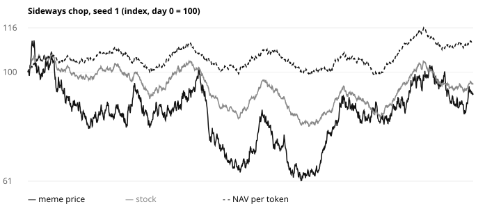
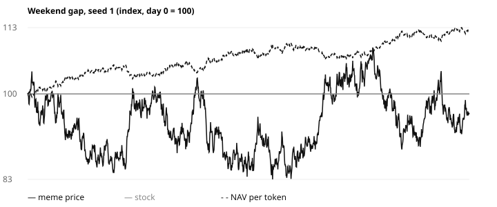

# Simulation results

Generated by `python3 simulation/sim.py`. Do not edit by hand.

## Setup

- Day 0 of every scenario is the end of a 90-day launch: a fresh pool seeded with 10,000 USDC and the full supply, then hype buying. The treasury is built only by pool fees and issuance, exactly as in the contract.
- Traders move the meme by 1.5x the stock's move, plus a hype drift and noise (5%/day). Sellers redeem at NAV while the redemption window is open and the pool pays less; arbitrageurs buy below NAV and redeem.
- 5-minute steps, `rebalance()` every hour, 30-minute TWAP, 15-minute oracle staleness brake, 1% slippage on every stock trade.
- Each scenario runs 12 seeds. Tables show the median across seeds; "Min mNAV" and "Longest < 0.9" are the worst seed.

## Results (median of 12 seeds)

| Scenario | Meme | Stock | NAV/token | Corr | Beta | Meme max DD | Stock max DD | Min mNAV | Longest < 0.9 | Supply | Stock units/token |
| --- | --- | --- | --- | --- | --- | --- | --- | --- | --- | --- | --- |
| Steady bull | +31.1% | +28.7% | +47.9% | 0.55 | 1.36 | -22.1% | -8.0% | 1.07 | 0 h | +7.1% | +13.1% |
| Bull then hype fades | -24.7% | +28.7% | +56.6% | 0.50 | 1.34 | -46.1% | -9.6% | 0.87 | 1 h | -1.6% | +29.1% |
| Stock crash | -46.9% | -31.6% | +3.9% | 0.59 | 1.35 | -54.4% | -36.0% | 0.87 | 1 h | -22.6% | +68.8% |
| Sideways chop | -19.6% | -4.7% | +22.1% | 0.66 | 1.43 | -39.9% | -18.5% | 0.88 | 1 h | +1.2% | +34.7% |
| Weekend gap | -19.0% | +0.0% | +18.5% | n/a | n/a | -30.5% | +0.0% | 0.88 | 1 h | +1.7% | +22.9% |

## Checks from docs/SPEC.md

| Scenario | Check | Result |
| --- | --- | --- |
| Steady bull | every issuance is accretive (all seeds) | pass |
| Steady bull | median meme return > median stock return | pass |
| Steady bull | median beta to the stock > 1 | pass |
| Steady bull | stock units per token rise (all seeds) | pass |
| Bull then hype fades | every issuance is accretive (all seeds) | pass |
| Bull then hype fades | mNAV back at >= 0.9 within 2 hours of dropping below (all seeds) | pass |
| Stock crash | every issuance is accretive (all seeds) | pass |
| Stock crash | meme falls with the stock (median return < 0, median corr > 0) | pass |
| Stock crash | mNAV back at >= 0.9 within 2 hours of dropping below (all seeds) | pass |
| Sideways chop | every issuance is accretive (all seeds) | pass |
| Sideways chop | supply growth per day within the 1% cap (all seeds) | pass |
| Weekend gap | every issuance is accretive (all seeds) | pass |
| Weekend gap | no mNAV action while the oracle is stale (all seeds) | pass |

## Finding: buyback must not sell stock

Tokens bought back come from the pool's inventory, not from holders, so circulating supply does not fall and each buyback lowers NAV per token. Under the SPEC v1 rule (spend cash down to the 10% refill level), the refill then sells stock to top cash back up, and the next buyback spends it again. Adopted rule: a buyback only spends cash above the 20% buffer and never triggers a stock sale. Redemption, which is value-neutral, carries the floor.

| Stock crash, median of 12 seeds | Stock units per token, day 60 vs day 0 | NAV/token | Worst min mNAV |
| --- | --- | --- | --- |
| SPEC v1 buyback (cash down to 10%) | +56.4% | +0.9% | 0.89 |
| Adopted (cash above 20% only) | +68.8% | +3.9% | 0.87 |

## Charts (seed 1)

